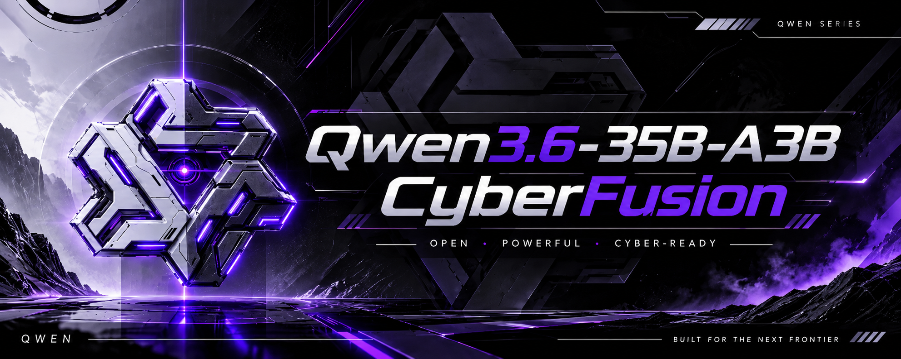

# Qwen3.6-35B-A3B-CyberFusion




## Intelligence for the frontier between code and security

**Qwen3.6-35B-A3B-CyberFusion** is a high-capability cybersecurity-focused model merge built from three Qwen3.6-35B-A3B fine-tunes:

- General instruction following from **Qwopus**
- Reasoning behavior from **Kimi-K2.6 Reasoning Distilled**
- Cybersecurity and offensive-security expertise from **CyberStrike-OffSec**

The result is an experimental **bf16, non-quantized, Hugging Face Transformers model** designed for people who want one system that can reason through code, systems, attack paths, defensive controls, and technical security workflows.

> **CyberFusion is a research model, not a magic hacking button.** Use it for authorized security research, education, defensive engineering, CTFs, code review, threat modeling, and lab environments.

## What makes it CyberFusion?

CyberFusion is built to combine broad language capability with security-oriented technical thinking. Depending on the prompt and evaluation setup, it can help with:

- Threat modeling and attack-surface analysis
- Secure code review and vulnerability triage
- Defensive security engineering
- Incident-response reasoning and investigation planning
- Network, operating-system, and application-security concepts
- CTF and sandbox challenge analysis
- Detection logic, hardening checklists, and remediation plans
- Technical documentation and security automation drafts
- General reasoning, coding, and structured problem solving

Always validate generated commands, exploit descriptions, indicators, and remediation steps in an isolated environment. Model output is untrusted by default.

## Merge architecture

CyberFusion was created through a two-stage sequential SLERP merge:

| Stage | A | B | `t` |
|---|---|---|---:|
| 1 | [`Jackrong/Qwopus3.6-35B-A3B-v1`](https://huggingface.co/Jackrong/Qwopus3.6-35B-A3B-v1) | [`lordx64/Qwen3.6-35B-A3B-Kimi-K2.6-Reasoning-Distilled`](https://huggingface.co/lordx64/Qwen3.6-35B-A3B-Kimi-K2.6-Reasoning-Distilled) | `1/2` |
| 2 | Stage 1 | [`oyildirim/CyberStrike-OffSec-35B`](https://huggingface.co/oyildirim/CyberStrike-OffSec-35B) | `1/3` |

The sequential interpolation gives the three source models an approximately equal contribution under the selected merge construction.

### Component decisions

- **Precision:** bfloat16
- **Format:** Hugging Face Transformers layout
- **Quantization:** none
- **MTP head:** taken from the Qwopus/Kimi side because CyberStrike does not provide MTP tensors
- **Config:** taken from Qwopus
- **Tokenizer:** taken from Qwopus
- **Chat template:** taken from Qwopus
- **Merge tooling:** `merge_models.py` from `C:\Users\lasha\qwen-merge`

## Not included in this release

[`jedisct1/Qwen3.6-35B-rust-v2-bf16.mlx`](https://huggingface.co/jedisct1/Qwen3.6-35B-rust-v2-bf16.mlx) was intentionally left out of this three-way release. It is reserved for a future equal four-way merge using:

```text
merge_models.py --b-format mlx --t 0.25
```

## Quick start

```python
from transformers import AutoModelForCausalLM, AutoTokenizer

model_id = "Kernel-Lord/Qwen3.6-35B-A3B-CyberFusion"

tokenizer = AutoTokenizer.from_pretrained(
    model_id,
    trust_remote_code=True,
)

model = AutoModelForCausalLM.from_pretrained(
    model_id,
    torch_dtype="auto",
    device_map="auto",
    trust_remote_code=True,
)

messages = [
    {
        "role": "user",
        "content": "Create a defensive threat model for a small web API.",
    }
]

prompt = tokenizer.apply_chat_template(
    messages,
    tokenize=False,
    add_generation_prompt=True,
)

inputs = tokenizer(prompt, return_tensors="pt").to(model.device)
outputs = model.generate(**inputs, max_new_tokens=700)
print(tokenizer.decode(outputs[0], skip_special_tokens=True))
```

Use the repository tokenizer and chat template. Do not manually reconstruct the prompt format unless you are intentionally testing a different serving setup.

## Responsible security use

CyberFusion may discuss dual-use security topics. Use it only in environments where you have explicit authorization. Do not use it to compromise systems, steal credentials, deploy malware, evade detection, or access data without permission.

For legitimate security work:

1. Run the model in an isolated environment.
2. Treat generated code and commands as untrusted.
3. Test only against systems you own or are authorized to assess.
4. Add human review before execution.
5. Log activity and preserve rollback paths.
6. Prefer defensive, educational, and remediation-oriented workflows.

## Model limitations

This is a merged model, not a separately trained foundation model. Merging can create uneven behavior, regressions, formatting changes, hallucinations, or incompatibilities with some inference stacks. Cybersecurity output can be technically wrong, incomplete, unsafe, or out of date. Benchmark the exact revision on your own tasks before deployment.

No performance claims are made here until reproducible evaluations are published.

## Repository contents

- `README.md` - this model card and usage guide
- `merge_recipe.json` - machine-readable merge provenance
- `assets/cyberfusion-banner.png` - primary project banner
- `docs/RELEASE_CHECKLIST.md` - release validation checklist
- `docs/EVALUATION.md` - evaluation template
- `CITATION.cff` - citation metadata

## License and attribution

The upstream licenses and usage conditions apply. Before redistributing weights, verify the license terms of all three source repositories and preserve any required notices. This project does not assert a single upstream license until those terms have been checked.

## Citation

```bibtex
@misc{cyberfusion_qwen36_35b_a3b,
  title        = {Qwen3.6-35B-A3B-CyberFusion},
  author       = {KernelLord},
  year         = {2026},
  howpublished = {Hugging Face model repository},
  note         = {Cybersecurity-focused sequential SLERP merge of three Qwen3.6-35B-A3B fine-tunes}
}
```
